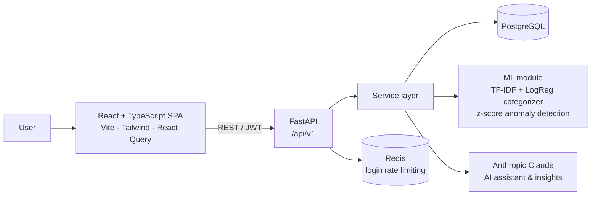

<div align="center">

# 💸 SmartSpend AI

**A full-stack personal finance platform with ML-powered categorization, anomaly alerts and an AI money assistant.**

Track every rupee across accounts, set budgets and savings goals, import bank statements, and ask questions about your spending in plain English.


[](https://github.com/Shweta173/smartspend-ai/actions/workflows/ci.yml)

</div>

---

## ✨ Highlights

| | |
| --- | --- |
| 🤖 **AI finance assistant** | Chat about your money ("Where did I overspend this month?"). Answers come from Claude (Anthropic), grounded in numbers the backend calculates. The model never invents figures, and a rule-based fallback works without an API key. |
| 🧠 **Smart auto-categorization** | New transactions are categorized by keyword rules first, then by a **TF-IDF + Logistic Regression** model trained on the user's own labeled history (used only when confidence is 50% or higher). |
| 🚨 **Anomaly detection** | Each expense is compared with the history for its category using a **z-score**. Unusually large spends are flagged and raise an alert. |
| 📊 **Analytics & forecasting** | Monthly income vs. expenses, category breakdowns, a 6-month trend, and a **linear forecast** of next month's income, spending and savings. |
| 🎯 **Budgets & goals** | Per-category monthly budgets with threshold and over-limit alerts, plus savings goals with progress tracking and deposits. |
| 📥 **Bank statement import** | Upload a CSV, preview it, and import. Column names (`narration`, `particulars`, `value_date`, `withdrawal`…) and six date formats are detected automatically. |
| 🔐 **Secure by design** | JWT access + refresh tokens, Argon2 password hashing, **Redis-backed login rate limiting** (10 attempts per 15 minutes), security headers (HSTS in production, X-Frame-Options, etc.), and API docs hidden in production. |

## 🖥️ App pages

**Dashboard** · **Transactions** (search, filter, CSV export) · **Accounts** (savings, current, cash, credit card, wallet, investment) · **Categories** · **Budgets** · **Goals** · **Analytics** · **Import** · **AI Assistant** · **Alerts** · **Settings**, plus a public landing page and login/register.

## 🏗️ Architecture



The backend follows a layered structure: **routers** (`api/v1/endpoints`) → **services** (business logic) → **models** (SQLAlchemy 2.0), with **Pydantic** schemas for validation.

## 🧰 Tech stack

| Layer | Technologies |
| --- | --- |
| **Frontend** | React 18, TypeScript, Vite, Tailwind CSS, Radix UI, TanStack React Query, React Hook Form + Zod, Recharts, Axios |
| **Backend** | Python 3.12, FastAPI, SQLAlchemy 2.0, Alembic, Pydantic v2, python-jose (JWT), passlib + Argon2 |
| **Data / ML** | pandas, NumPy, scikit-learn |
| **AI** | Anthropic Claude API |
| **Infrastructure** | PostgreSQL 16, Redis 7, Docker, Docker Compose, Nginx, GitHub Actions CI |

## 📁 Project structure

```
smartspend-ai/
├── backend/
│   ├── app/
│   │   ├── api/v1/endpoints/   # auth, transactions, accounts, categories, budgets,
│   │   │                       # goals, analytics, ai, alerts, imports
│   │   ├── core/               # config, database, security (JWT, hashing)
│   │   ├── ml/                 # categorizer.py, anomaly.py
│   │   ├── models/             # SQLAlchemy models
│   │   ├── schemas/            # Pydantic request/response models
│   │   ├── services/           # business logic
│   │   └── main.py             # app factory, middleware, routers
│   ├── scripts/seed_data.py    # demo user + sample data
│   ├── tests/                  # pytest
│   └── Dockerfile
├── frontend/
│   ├── src/
│   │   ├── pages/              # one folder per screen
│   │   ├── components/         # charts, layout, shared UI
│   │   ├── services/api/       # Axios client with auto token refresh
│   │   └── contexts/           # auth state
│   ├── nginx.conf
│   └── Dockerfile
├── .github/workflows/ci.yml    # lint, tests, typecheck, build, Docker build
├── docker-compose.yml
└── .env.example
```

## 🚀 Getting started

### Option 1: Docker (recommended)

**Prerequisites:** Docker Desktop

```bash
git clone https://github.com/Shweta173/smartspend-ai.git
cd smartspend-ai
cp .env.example .env        # then edit SECRET_KEY, POSTGRES_PASSWORD and (optionally) ANTHROPIC_API_KEY
docker compose up --build
```

| Service | URL |
| --- | --- |
| Web app | http://localhost:5173 |
| API | http://localhost:8000 |
| API docs (Swagger) | http://localhost:8000/docs |

The backend seeds a demo account on startup:

> **Email:** `demo@smartspend.ai` · **Password:** `Demo@1234`

### Option 2: Run the backend without Docker

**Prerequisites:** Python 3.12, PostgreSQL, Redis

```bash
cd backend
python -m venv .venv
source .venv/bin/activate          # Windows: .venv\Scripts\activate
pip install -r requirements.txt
# set POSTGRES_SERVER=localhost and REDIS_URL=redis://localhost:6379/0 in ../.env
python scripts/seed_data.py
uvicorn app.main:app --reload
```

### Environment variables

| Variable | Purpose |
| --- | --- |
| `POSTGRES_*` | Database connection |
| `REDIS_URL` | Redis connection |
| `SECRET_KEY` | JWT signing key (use a long random string) |
| `ACCESS_TOKEN_EXPIRE_MINUTES` / `REFRESH_TOKEN_EXPIRE_DAYS` | Token lifetimes |
| `ANTHROPIC_API_KEY` | Optional. Enables the AI assistant (falls back to rule-based answers without it) |
| `BACKEND_CORS_ORIGINS` | Allowed frontend origins |

See [`.env.example`](.env.example) for the full list.

## 🧪 Testing & CI

```bash
# backend
cd backend && ruff check app && pytest tests/ -v

# frontend
cd frontend && npx tsc --noEmit && npm run build
```

GitHub Actions runs all of the above on every push and pull request, and builds both Docker images on `main`.

## 🔌 API overview

| Area | Endpoints |
| --- | --- |
| Auth | `POST /auth/register`, `/auth/login`, `/auth/refresh` · `GET/PATCH/DELETE /auth/me` · `POST /auth/change-password` |
| Transactions | `GET/POST /transactions` · `GET/PATCH/DELETE /transactions/{id}` · `GET /transactions/export` |
| Accounts, Categories, Budgets | Full CRUD |
| Goals | CRUD + `POST /goals/{id}/deposit` |
| Analytics | `GET /analytics/dashboard`, `/monthly`, `/categories`, `/summary`, `/forecast` |
| AI | `POST /ai/chat`, `/ai/insights` · `GET/DELETE /ai/history` |
| Alerts | `GET /alerts` · `PATCH /alerts/{id}/read` · `POST /alerts/mark-all-read` |
| Imports | `POST /imports/preview`, `/imports/` · `GET /imports/` |

All routes are prefixed with `/api/v1`. Interactive docs are available at `/docs` when not running in production.

## 🗺️ Roadmap

- PDF monthly reports
- Recurring transactions and bill reminders
- Multi-currency support
- Persisting the trained categorizer model per user

## 🙏 Acknowledgements

Feature ideas were inspired by [**ezBookkeeping**](https://github.com/mayswind/ezbookkeeping) by mayswind (MIT License), an open-source, self-hosted personal finance app. SmartSpend AI is a separate implementation with its own stack (FastAPI + React) and adds ML categorization, anomaly detection and an AI assistant.

## 👩‍💻 Author

**Shweta Kamble**
[GitHub](https://github.com/Shweta173) · [LinkedIn](https://www.linkedin.com/in/shweta-kamble-dev)

---

<sub>The AI assistant offers educational guidance, not professional financial advice.</sub>
